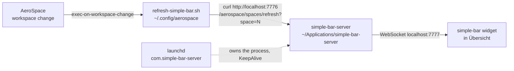

# Local Notes

This file tracks local simple-bar work in this checkout so future changes are easier to understand.

## Repo Layout

- Local repo path: `/Users/seonjunkim/Library/Application Support/Übersicht/widgets/simple-bar`
- `origin`: `https://github.com/seonjunn/simple-bar.git`
- `upstream`: `https://github.com/Jean-Tinland/simple-bar`

## Upstream PR

- PR: <https://github.com/Jean-Tinland/simple-bar/pull/509> — **merged** upstream as `6e513bf`.
- Branch: `seonjun-pr-aerospace-race-fix`
- Commit: `08e9ebe Avoid stale AeroSpace refresh results`

Summary:

- Fixes an AeroSpace race where older async refreshes could finish after newer ones and temporarily redraw a stale focused space.
- The patch uses a last-request-wins guard in `lib/components/aerospace-context.jsx`.

**Scope, and what it is not.** #509 changed `lib/components/aerospace-context.jsx`
and nothing else, +7 lines. It does not touch the wedge. The two failure modes
look identical from the outside — "the bar stops following AeroSpace" — so it is
easy to assume #509 covered a wedge incident. It did not:

- #509 fixes *flicker*: the bar briefly redraws a stale focused space.
- The wedge is *a full stop*: the bar freezes until a stuck client is killed.

If the bar has stopped rather than flickered, #509 is not the relevant patch —
go to the incident entries below.

## Upstream Status (surveyed 2026-09-17)

Baseline for this survey: `upstream/master` at `fb5cada`, local `master` at
`37387be`. **0 ahead, 81 behind.**

### Nothing upstream fixes the wedge

Checked directly rather than inferred, because the assumption that "#509 handled
it" is the easy mistake here:

- `upstream/master:lib/aerospace.js` has **no queue and no timeout** — every call
  is still a bare `Uebersicht.run`. Both the 2026-09-14 queue and the 2026-09-17
  deadline are local-only.
- The one upstream commit touching that file since our HEAD is `cd98f45`, a pure
  rename: `getCustomDisplayIndex` → `getDisplayIndex`.
- `eb65603 "implement caching for command execution (better multi display
  support)"` sounds relevant and is not: it covers `lib/components/data/*` and
  `lib/utils.js`, and never reaches AeroSpace.
- `upstream/master:lib/hooks/use-server-socket.js` **still leaks** — no cleanup in
  the effect, and the `socket.current === null` guard still binds `onmessage`
  once with a stale closure. The two commits touching it only added widget keys
  (next-meeting, notifications) to `settingsKeys`.

So pulling does not fix, and is not needed to keep, anything in the incidents
below.

### What a pull would actually cost

- At commit level it is a clean **fast-forward** — HEAD is an ancestor of
  `upstream/master`, so there are no commit-level conflicts.
- The real obstacle is the uncommitted working tree. Ten files are modified, and
  upstream has since changed **seven** of them, so `git pull` is refused outright
  until they are committed or stashed:

  | file | upstream commits since HEAD |
  | --- | --- |
  | `lib/components/simple-bar-context.jsx` | 6 |
  | `lib/components/aerospace-context.jsx` | 3 |
  | `lib/hooks/use-server-socket.js` | 2 |
  | `lib/aerospace.js` | 1 |
  | `lib/components/aerospace/opened-apps.jsx` | 1 |
  | `lib/components/aerospace/spaces.jsx` | 1 |
  | `lib/components/data/wifi.jsx` | 1 |

- One genuine merge decision, not just a textual conflict: the local
  `getCustomDisplayIndex(item, allDisplays)` with its built-in-first sorting
  fallback. Upstream did its own AeroSpace display-matching work in the meantime
  (`09dda97`, `d5bd922`, `aec8383`, plus the `cd98f45` rename), so check whether
  the local version is still needed before porting it forward.

Suggested order when the time comes: commit the local work to a branch first,
then rebase onto upstream in a scratch worktree, so the live widget directory is
never left half-merged.

### Pending upstream PRs, both still unfixed upstream

1. **Per-call deadline in `lib/aerospace.js`** (2026-09-17 incident). Argument for
   upstream: the module-scope queue only serializes one JS context, and Übersicht
   renders one widget instance per display, so any multi-monitor user still issues
   concurrent CLI calls — enough to wedge AeroSpace.
2. **`use-server-socket.js` socket leak** (2026-09-14 incident). Unrelated to
   AeroSpace and affects yabai users too, so it stands on its own.

## Local Working Tree

The main local checkout intentionally still has additional unmerged changes beyond the PR above.

Current local modifications, as of 2026-09-17. **None of this is committed** —
it lives only in the working tree, so it is one careless `git checkout` or
`git stash drop` away from being lost. Committing it to a branch is the first
step of any upstream merge (see "Upstream Status" below).

Modified:

- `lib/aerospace.js`
- `lib/components/aerospace-context.jsx`
- `lib/components/aerospace/opened-apps.jsx`
- `lib/components/aerospace/process.jsx`
- `lib/components/aerospace/space.jsx`
- `lib/components/aerospace/spaces.jsx`
- `lib/components/data/wifi.jsx`
- `lib/components/simple-bar-context.jsx`
- `lib/hooks/use-server-socket.js`
- `lib/styles/components/spaces/space.js`

Untracked:

- `AGENTS.md`
- `LOCAL_NOTES.md`
- `lib/aerospace-mode.js`
- `lib/scripts/get-ssid`

These are not all part of PR #509.

## AeroSpace / simple-bar Debugging Notes

Observed issue:

- During fast AeroSpace workspace switching, simple-bar could flicker between old and new focused spaces.

What turned out to matter:

- AeroSpace config-side event tuning helped responsiveness but did not fully remove flicker.
- The remaining problem was in simple-bar itself: overlapping async refreshes could resolve out of order.

Result:

- The robust fix was the simple-bar race guard now proposed upstream in PR #509.

## Local Config Context

Related local AeroSpace config repo:

- `/Users/seonjunkim/.config/aerospace`

Relevant local scripts added there during this work:

- `set-border.sh`
- `refresh-simple-bar.sh`

Those scripts are local machine glue and are not part of the simple-bar upstream PR.

## Runtime Topology

Space updates do not come from Übersicht's polling. They travel this chain, and a
break anywhere in it looks identical from the outside: the bar simply stops
following AeroSpace.



Ports come from `~/Applications/simple-bar-server/config.js` (7776 HTTP, 7777 WS)
and must match the widget's `serverHttpPort` / `serverSocketPort` settings. The
widget only uses this path when `enableServer` and `aerospaceServerRefresh` are
both on.

## Incident: 2026-08-07 — bar stopped following AeroSpace

Symptom: workspace switches no longer redrew the bar. Everything looked healthy —
AeroSpace was running, Übersicht was running, the widget was loaded.

Actual cause: `simple-bar-server` was not running, so every `curl` in the chain
above failed silently. Nothing was listening on 7776.

Why it was down — from `~/.pm2/pm2.log`, at the previous shutdown:

```text
15:21:06  App [simple-bar-server:0] exited with code [0] via signal [SIGTERM]
15:21:07  pm2 has been killed by signal, dumping process list before exit...
15:21:07  Deleting process 0
15:22:20  --- New PM2 Daemon started ---
```

The server was managed by pm2, and macOS SIGTERMs pm2 and its children
concurrently at shutdown. Here the child died one second before pm2 did, so pm2's
shutdown dump recorded `"status":"stopped"`, and the next boot's `pm2 resurrect`
faithfully restored that stopped state. It is a shutdown-ordering race, so it
only bites occasionally — the log shows roughly a year of otherwise clean
restores.

Two latent problems surfaced alongside it:

- The pm2 LaunchAgent's `PATH` was `/usr/local/texlive/2024/bin/universal-darwin:/opt/homebrew/Cellar/node/24.5.0/bin`
  — no `/bin`, so pm2's `pidusage` could not spawn `ps`. It logged
  `spawn ps ENOENT` every 30s (grew `pm2.log` to 40 MB) and reported 0% CPU / 0b
  memory for the app.
- That same `PATH` pinned an exact Homebrew Cellar node version, which would
  break on any `brew upgrade node`.

### Fix: pm2 replaced with a dedicated LaunchAgent

`~/Library/LaunchAgents/com.simple-bar-server.plist` now runs
`/opt/homebrew/bin/node index.js` directly under launchd with `KeepAlive` and
`RunAtLoad`. launchd owns the process, so there is no serialized "last known
state" to race against at shutdown — the failure mode above cannot recur.

- `PATH` is `/opt/homebrew/bin:/usr/bin:/bin:/usr/sbin:/sbin`. Both halves
  matter: `services/yabai.js` and `services/skhd.js` shell out via `exec`.
- `/opt/homebrew/bin/node` is the stable symlink, not a Cellar path.
- Logs go to `~/Library/Logs/simple-bar-server.{log,error.log}`, which macOS
  `newsyslog` rotates.
- The old `pm2.seonjunkim.plist` was renamed to `.disabled` rather than deleted;
  launchd only auto-loads `*.plist`. Rename it back to restore the pm2 setup.
- `~/.pm2/pm2.log` (40 MB) and the stale `dump.pm2` were removed. pm2 itself is
  still installed, just no longer running anything.

Verified at the time: `kill -9` on the server respawned it in ~2s, and the full
`refresh-simple-bar.sh` chain returned HTTP 200.

## Incident: 2026-09-14 — bar stopped following AeroSpace (second time)

Same symptom as 2026-08-07, different cause. This time the whole server chain was
healthy: `com.simple-bar-server` was running, both ports listening, and a manual
`curl .../aerospace/spaces/refresh?space=1` returned HTTP 200.

### Actual cause: AeroSpace's CLI socket wedges, and the hook depended on it

AeroSpace 0.19.2-Beta serves `/tmp/bobko.aerospace-<user>.sock` one connection at
a time. The handler sits in `newConnection(_:)` → `Socket.wait(waitForever:)` →
`select` on a Swift cooperative-pool thread, waiting for the request to arrive.
Confirmed by `sample`: while wedged, exactly one cooperative thread is parked
there and the main thread is idle in its run loop.

Two consequences, both observed:

- A client that connects but never completes its request blocks *every* later
  command until that client's process dies. Killing the stuck clients unwedges
  AeroSpace instantly — verified repeatedly.
- `aerospace workspace N` **applies the switch and then hangs waiting for a reply
  that never comes**. So the workspace really does change while the CLI call
  blocks forever, leaving a stuck client behind that wedges the socket.

The old `refresh-simple-bar.sh` called `aerospace list-workspaces --focused` from
inside `exec-on-workspace-change`. Once the socket was wedged, that call hung, the
hook never reached its `curl`, and the bar stopped following AeroSpace — while
keybinding-driven switches kept working normally, which is what made it look like
simple-bar was at fault.

This is an AeroSpace bug, reproduced with Übersicht fully quit and
`exec-on-workspace-change` commented out entirely. simple-bar does not cause it;
it only made the wedge far more likely by issuing many concurrent CLI queries.

### Fixes applied

- `~/.config/aerospace/refresh-simple-bar.sh` — rewritten. It now reads
  `$AEROSPACE_FOCUSED_WORKSPACE` from the callback environment instead of
  shelling out to the AeroSpace CLI, and does its coalescing sleep and `curl` in
  a detached child so AeroSpace never waits on it. Backup:
  `refresh-simple-bar.sh.bak`. Verified: 6/6 workspace changes delivered
  `{"action":"refresh","data":{"space":"N"}}` to a WebSocket client.
- `lib/hooks/use-server-socket.js` — the effect created a WebSocket with no
  cleanup, and its `socket.current === null` guard meant `onmessage` was never
  rebound, so it kept a stale `handleMessage` closure. Every widget remount
  leaked a socket that went on answering broadcasts for an unmounted tree. The
  count had reached **115 and was still climbing**; each leaked generation
  replayed the full per-workspace `aerospace list-windows` fan-out on every
  workspace change. Now the socket is closed on cleanup and the handler is read
  through a ref. Steady state is **46** = 2 displays × 23 channels.
- `lib/aerospace.js` — every AeroSpace CLI call now goes through a module-level
  promise queue, so a widget instance holds at most one connection at a time
  instead of ~20 concurrent ones per refresh.

The `use-server-socket.js` leak is a genuine upstream bug and is worth a PR on its
own; it is unrelated to AeroSpace and affects yabai/flashspace users too.

### Still open

`aerospace workspace N` from the CLI still hangs on this machine (the switch
applies, the reply never arrives). Keybinding switches are unaffected, so the bar
follows workspaces correctly again. If CLI workspace switching matters, that
needs an AeroSpace upgrade or a bug report upstream — it is not fixable from
simple-bar.

> Superseded on 2026-09-17. The hang turned out to be intermittent rather than
> permanent, and it is what simple-bar's own click handler runs, so it was never
> merely cosmetic — see the 2026-09-17 incident below, which contains it.

Diagnostic shortcut: if the bar stops following AeroSpace again, check for stuck
clients first — `pgrep -fl /opt/homebrew/bin/aerospace`. Any long-lived process
there means the socket is wedged; killing them restores it.

## Service Runbook

```sh
# Is the service up? Both ports should be listening on 127.0.0.1.
lsof -nP -iTCP:7776 -sTCP:LISTEN
lsof -nP -iTCP:7777 -sTCP:LISTEN

# launchd's view (state, pid, last exit code)
launchctl print gui/$(id -u)/com.simple-bar-server

# Restart / logs
launchctl kickstart -k gui/$(id -u)/com.simple-bar-server
tail -f ~/Library/Logs/simple-bar-server.log
tail -f ~/Library/Logs/simple-bar-server.error.log

# Exercise the chain by hand
sh ~/.config/aerospace/refresh-simple-bar.sh
curl "http://localhost:7776/aerospace/spaces/refresh?space=1"   # expect HTTP 200

# After editing the plist
launchctl bootout    gui/$(id -u)/com.simple-bar-server
launchctl bootstrap  gui/$(id -u) ~/Library/LaunchAgents/com.simple-bar-server.plist
```

`~/Applications/simple-bar-server/package.json` also carries
`npm run service:restart` and `npm run service:log` as shortcuts.

### Gotcha: the refresh script's state file

`refresh-simple-bar.sh` writes the focused space to
`/tmp/aerospace-simple-bar-last-space` *before* issuing the `curl`, and skips the
refresh when the space is unchanged. So a failed refresh still marks that space
as delivered, and returning to it will not retry. When testing by hand, `rm -f`
that file first or the script will look like a no-op.

## Related Repo: simple-bar-server

- Path: `~/Applications/simple-bar-server`
- `origin`: `https://github.com/Jean-Tinland/simple-bar-server` — a direct clone,
  not a fork, so local edits drift against upstream.

Local drift as of 2026-08-07:

- `package.json` — `ws` bumped to `^8.18.3`; `start` changed from
  `pm2 startOrRestart ./ecosystem.config.cjs` to `node index.js`, plus the
  `service:*` shortcuts. The old `start` would resurrect the pm2 daemon and fight
  launchd for port 7776.
- `package-lock.json` — follows the `ws` bump.
- `ecosystem.config.cjs` is now unreferenced but left in place, since it is
  upstream-tracked and deleting it would only widen the diff.

On `git pull`, expect a conflict in `package.json` and keep the local side.

## Incident: 2026-09-17 — clicking a workspace in the bar did nothing

Third occurrence of the same outward symptom, and the first one traced all the
way to its trigger.

Reported as: clicking a space in simple-bar does not switch to it. Everything
else looked healthy — AeroSpace running, Übersicht running, the bar rendering,
`com.simple-bar-server` up with both ports listening.

### Cause

The AeroSpace socket was wedged, by two clients stuck since 11:46:05 that day:

```text
aerospace list-windows --workspace Slack   --json
aerospace list-windows --workspace Spotify --json
```

Both had been alive for 3h38m. With the socket wedged, the click handler
(`space.jsx` → `Aerospace.goToSpace()` → `aerospace workspace N`) queued behind
them and never ran, so clicks did nothing while keybinding switches — which never
touch the CLI socket — kept working. `kill` on the two clients restored it
immediately.

### What the earlier entries got wrong

Two corrections to the 2026-09-14 notes:

- The queue added to `lib/aerospace.js` serializes **one JS context**. Übersicht
  renders a widget instance per display, so this two-monitor machine still issues
  two concurrent CLI calls. Two is enough to wedge AeroSpace. Confirmed: both
  stuck clients started in the same second, and a stress run peaks at exactly 2
  concurrent clients.
- `aerospace workspace N` hanging was filed as "still open" and cosmetic. It is
  neither. It is **intermittent**, not permanent — measured at 66–131 ms when it
  behaves — and a quick retest looked clean only because the target workspace was
  already focused, so no switch actually happened. When it does hang, it is the
  exact call the bar's own click handler makes, so a click is itself a way to
  wedge the socket and kill the bar.

### Fix: every AeroSpace call gets a deadline

A wedge lasts exactly as long as the stuck client's process, so no call may run
unbounded. macOS ships no `timeout`, but `/usr/bin/perl` is always present and an
`alarm(2)` timer survives `exec` — so the timer kills the AeroSpace client
itself, not merely our wait for it:

```sh
/usr/bin/perl -e 'alarm shift; exec @ARGV or die' 5 aerospace list-windows ...
```

Verified before use: stdout passes through unchanged, exit is 0 on success, and a
hung child dies at the deadline with exit 142 (SIGALRM).

`lib/aerospace.js` now routes every call through it, with two deadlines:

- `QUERY_TIMEOUT` (5s) for the read-only queries.
- `ACTION_TIMEOUT` (1s) for `workspace` and `focus`. These are the ones that hang
  after applying, and the bar's refresh queues behind them, so this deadline is
  what the user feels after a click. Killing the client does not undo an applied
  switch, and the bar learns the new state from `exec-on-workspace-change`
  anyway, so the lost reply costs nothing. `runAction` swallows the rejection,
  since `onClick` does not await it.

The failure mode is now self-healing: worst case the bar lags one deadline, then
recovers on its own. It can no longer stop until someone runs `kill` by hand.

Verified after the change: 8 rapid switches at 66–131 ms each, peak 2 concurrent
clients, zero leftovers, socket healthy, and the bar tracking the focused
workspace.

### Dead ends, recorded so they are not retried

- `timeout` / `gtimeout` work but come from coreutils, which upstream users will
  not have. The perl form needs nothing that macOS lacks.
- `ps` cannot tell a wrapped call from an unwrapped one: perl `exec`s into
  `aerospace`, replacing its own process image, so only `aerospace` is ever
  visible.
- `nc -U` does not reproduce a wedge. With `< /dev/null` it sends EOF and
  AeroSpace answers `Empty request`; holding the connection open did not wedge it
  either. Reproduce with a real workspace switch instead.
- A WebSocket probe of simple-bar-server must connect as
  `ws://localhost:7777?target=spaces`. Without a `target` the server closes the
  connection at once (`index.js`, `wss.on("connection")`), which looks exactly
  like a broken broadcast.
- Sampling with `ps` in a loop misses these calls; a healthy one lives ~55 ms.
  Absence of processes in a sample proves nothing.
